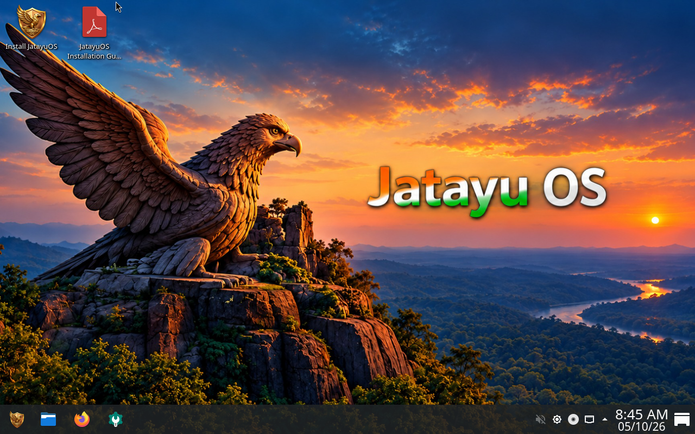

<div align="center">


# JatayuOS 1.0 · Udaan

**Udaan Aapki. Shakti Bharat Ki.**

Made in India · Debian 13 Trixie · KDE Plasma 6.3.6 · AMD64

### [Download & explore JatayuOS](https://jatayuos.in)

[Release 1.0 Udaan](https://github.com/jatayuos4u/jatayuos/releases/tag/v1.0-udaan) · [User Manual](assets/USER-MANUAL.pdf) · [Installation Guide](assets/INSTALLATION-GUIDE.pdf) · [FAQ](assets/FAQ.pdf)

</div>

---

JatayuOS is an independent desktop Linux distribution maintained by **Anup Yadav**.
It combines Debian 13 Trixie and KDE Plasma with Jatayu applications, illustrated
offline help and a desktop prepared for browsing, documents and creative work.



*Desktop overview. See [screenshot provenance](docs/SCREENSHOTS.md) for the original testing captures.*

## Get JatayuOS

**[jatayuos.in — official website and download destination](https://jatayuos.in)**

The website will provide ISO downloads, installation guidance and links to
SourceForge. Website setup and permanent ISO delivery are in progress.
The planned SourceForge launch is **11 October 2026**, after final validation
and publication checks.

The [GitHub 1.0 Udaan release](https://github.com/jatayuos4u/jatayuos/releases/tag/v1.0-udaan) records the earlier Build #37 source.
The final, maintainer-tested and accepted ISO is **Build #38**, recorded below. This repository and its release remain **private**.
The ISO is not attached to the GitHub release.

## Your desktop, ready for everyday work

| Experience | Included tools |
| --- | --- |
| Desktop and files | KDE Plasma, Dolphin and image/thumbnail preview backends |
| Browsing and productivity | Firefox ESR and LibreOffice |
| Welcome and help | Aarambh with help, settings and application shortcuts |
| Creative work | Jatayu Tools Creative Studio for local image and PDF workflows |
| Personalization | Wallpaper Changer with an offline collection |
| Information and shortcuts | Kavach, Sarkar Setu and Utsav |
| Software installation | Debian APT packages and Flatpak apps from Flathub through Discover |
| System information and audio | Info Center with JatayuOS branding, diagnostic helpers and RTKit |
| Android setup | Waydroid on demand through Android Setup; Android images and initialization are separate |

Sarkar Setu links to external services and does not imply government affiliation.
Waydroid requires compatible session, kernel and graphics support; Google apps
and ARM translation are not bundled.

## System requirements

| Component | Requirement |
| --- | --- |
| Processor / architecture | 64-bit x86 processor; AMD64 (x86-64) |
| RAM | **4 GB minimum; 8 GB recommended** |
| Installation storage | At least 25 GB available; allow more for applications and personal files |
| Internet | Not required for installation; required for updates, new downloads and Android image setup |

Calamares retains a 1.5 GB installer threshold. This allows installation on
lower-memory systems; the product's usable-performance minimum remains 4 GB.

## 1.0 Udaan build record

The latest ISO was assembled successfully on **7 October 2026**.

| Detail | Verified value |
| --- | --- |
| Existing release tag | `v1.0-udaan` (earlier Build #37 source) |
| Build | [GitHub Actions #38](https://github.com/jatayuos4u/jatayuos/actions/runs/37589010270) — successful |
| Artifact-producing source | `eb7d73a1b1b7ea55174a9caeda2ff2824ec259a3` |
| Base / desktop | Debian 13 Trixie / KDE Plasma 6.3.6 |
| Architecture | AMD64 (x86-64) |
| ISO filename | `JatayuOS-1.0-Udaan-amd64.iso` |
| ISO size | 2,373,058,560 bytes (2.21 GiB) |
| Integration / installer | `1.0` / Calamares `3.3.14-1+jatayu3` |
| ISO SHA256 | `5a5dbc79f724c8353f1173e55edde3f905d9ddb287272d492930e6730650e040` |

Static and dependency/source prechecks, assembled-image checks and ISO structure
validation passed. The CI suite ran 15 tests: 14 passed and one backup round-trip
test was skipped because the builder lacks rsync. All 15 passed in local validation.
The maintainer verified the downloaded ISO against bundled SHA256SUMS on
7 October 2026 and confirmed the Build #38 source commit. See the
[recorded checksum](docs/releases/1.0-udaan-build38.SHA256SUMS) and
[verification result](docs/VERIFY-ISO.md#recorded-build-38-verification).
The maintainer confirmed on **9 October 2026** that the final Build #38 ISO was
tested and passed, completing final boot/install acceptance. This records the
maintainer's acceptance, rather than independent certification of every hardware
or installation scenario. Public ISO download delivery remains pending.

Build #38 adds explicit Info Center helpers, RTKit, Flatpak/Discover/Flathub,
JatayuOS Info Center branding and authenticated on-demand Waydroid controls.
Baloo indexing and its KRunner file-search provider are disabled by default;
launcher favourites contain installed applications. See the
[full change record and acceptance checklist](docs/FINAL-BUILD-2026-10-07.md).

<details>
<summary>Maintainer: temporary build artifact and validation records</summary>

The [private ISO bundle](https://github.com/jatayuos4u/jatayuos/actions/runs/37589010270/artifacts/11468269941)
expires **8 October 2026 at 08:09:32 UTC (13:39:32 IST)**. Preserve it before
expiry. The bundle includes checksum/provenance files, package manifests and
notices. The Actions ZIP digest is not the ISO checksum. See
[how to verify the downloaded ISO](docs/VERIFY-ISO.md).

[Current status](docs/STATUS.md) · [Release notes](docs/RELEASE-1.0.md) ·
[Build metadata](docs/releases/1.0-udaan-final.json) ·
[Release checklist](docs/RELEASE-CHECKLIST.md)

</details>

## Documentation

| Guide | Purpose |
| --- | --- |
| [User Manual · edition 2](assets/USER-MANUAL.pdf) | 16 illustrated pages covering the desktop and Jatayu apps |
| [Installation Guide · edition 2](assets/INSTALLATION-GUIDE.pdf) | 6 pages of installation guidance and precautions |
| [FAQ · edition 2](assets/FAQ.pdf) | 5 pages of common questions |
| [Quick user guide](docs/USER-GUIDE.md) | Repository-readable help |
| [Windows dual boot](docs/DUAL-BOOT.md) | Partition preservation and validation guidance |
| [Update policy](docs/UPDATES.md) | Debian updates and Jatayu application delivery |
| [Document inventory](docs/DOCUMENTATION.md) | Versions, committed PDF hashes and capture provenance |

Build #38 regenerated and bundled the edition 2 guides with updated Flatpak
and on-demand Android instructions. Repository PDF hashes
describe committed documents; generated document hashes are in the build bundle.

## Updates and support

Debian package updates are available through **APT/Discover**. Flatpak apps
receive updates through **Flatpak/Discover** from their configured remote. A signed Jatayu
application repository is not yet configured. New ISO releases do not
automatically upgrade installed systems.

For support, use [GitHub Issues](https://github.com/jatayuos4u/jatayuos/issues)
when you have repository access, or email **jatayuos4u@gmail.com**. Include the
ISO checksum, boot mode, hardware/VM details, reproduction steps and relevant
logs. Remove private data before sharing.

Secure Boot, encryption, every Windows disk layout and universal Android
compatibility have not been certified. Check the [testing checklist](docs/TESTING.md)
and installation guidance before changing disks.

## Build from source

Use a dedicated privileged Debian 13 builder with mount/chroot support and
sufficient disk space.

```sh
python3 scripts/preflight.py
sudo bash scripts/build.sh --precheck-only
sudo bash scripts/build.sh
```

The full build runs the dependency/source precheck before compilation.
Output includes `out/JatayuOS-1.0-Udaan-amd64.iso`, `SHA256SUMS`,
package manifests and notices. Regenerate offline guides with
`python3 scripts/generate-documentation.py` using ReportLab and DejaVu fonts.

Manual full Actions builds target main and require the BUILD confirmation.
The job cap is 50 minutes; artifact retention is one day. Ordinary source and
documentation edits do not start an ISO build. Builds do not automatically
publish a release.

## Credits and licensing

Created and maintained by **Anup Yadav**. JatayuOS builds on the work of
**Debian, Linux, KDE, Mozilla, LibreOffice, Qt, Calamares, Fcitx, Waydroid**
and many other upstream contributors, who retain their authorship, licences
and marks.

Original Jatayu software is **GPL-3.0-or-later**, within the scope recorded in
[COPYRIGHT.md](COPYRIGHT.md); see [LICENSE](LICENSE). Third-party components,
documentation and artwork have separate terms. The software licence does not
grant trademark rights or imply endorsement by upstream projects or government.

[Third-party credits](THIRD-PARTY-NOTICES.md) ·
[Publication checklist](docs/COMPLIANCE.md) ·
[Source audit](docs/legal/PUBLICATION-AUDIT.md) ·
[Corresponding-source procedure](docs/legal/SOURCE-PUBLICATION.md) ·
[Creative Studio source bundle](vendor/jatayu-tools-2.0.2-source.tar.gz)

Corresponding-source delivery, artwork/documentation permissions and upstream
redistribution review remain tracked before public ISO distribution.

---

<div align="center">

**JatayuOS · Made in India**

[Official website & downloads](https://jatayuos.in) · [Release](https://github.com/jatayuos4u/jatayuos/releases/tag/v1.0-udaan) · [Documentation](docs/DOCUMENTATION.md)

</div>
