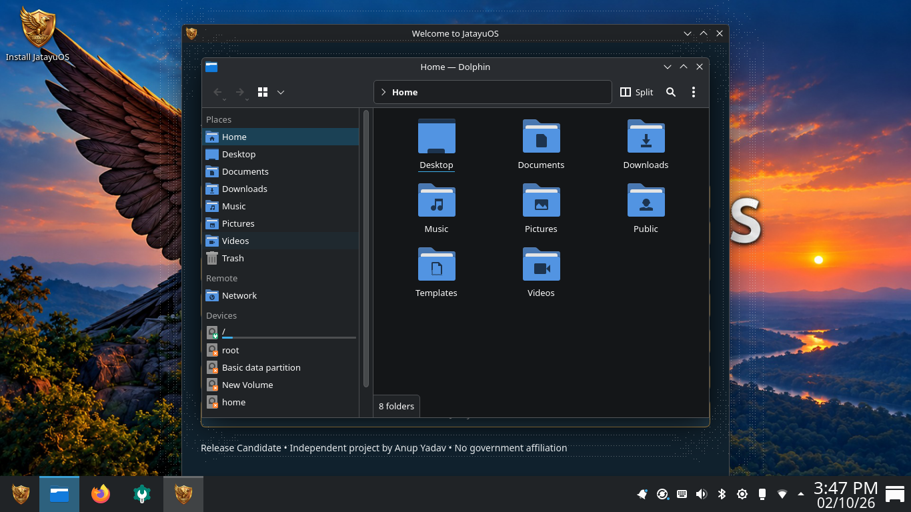
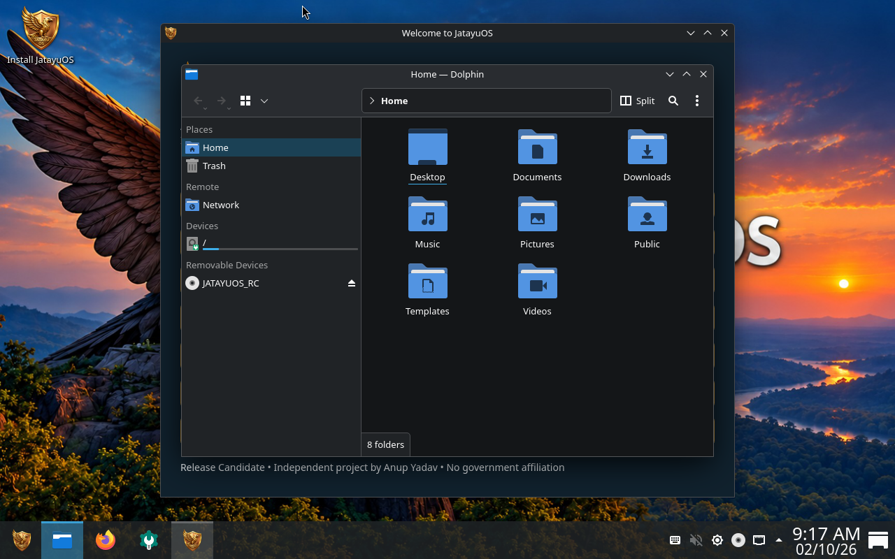

# JatayuOS 1.0 (Udaan) documentation screenshots

Official website: https://jatayuos.in

These are genuine owner-provided testing-build captures from 2 October 2026, embedded unchanged. They are not screenshots of a completed 1.0 ISO.

## Desktop and Dolphin on a real PC

## Earlier VM sidebar issue

The second image illustrates troubleshooting, not intended release behavior. Device names and window labels reflect the original test environment.

Before public release, replace or supplement these with fresh captures from the exact tested ISO: desktop, Aarambh, installer, About, approved Fastfetch, Firefox with all controls, Wallpaper Changer, and LibreOffice. Preserve capture provenance; do not manufacture runtime screenshots.
